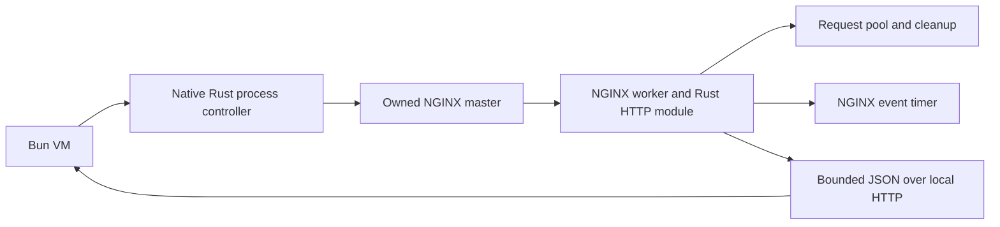

# Native NGINX controller

`bun:nginx` and the literal spelling `bun:Nginixx` resolve to the same Rust
process controller. NGINX's selected native executable owns its configuration,
HTTP engine and compiled modules. The optional `@aphrody/bun-nginx` package
re-exports the builtin and its types.

```ts
import Nginx from "bun:nginx";

const provider = await Nginx.probe({ binary: "/usr/sbin/nginx" });
if (!provider.available) throw new Error(provider.message);

await using nginx = await Nginx.create({
  binary: "/usr/sbin/nginx",
  prefix: "/home/ubuntu/apps/my-nginx",
  configFile: "nginx.conf",
  timeoutMs: 10_000,
});
await nginx.validate();
const started = await nginx.start();
console.log(started.pid);
await nginx.reload();
```

The prefix must already exist and the configuration must resolve inside it.
Omit `daemon` and `pid` directives: Bun supplies foreground mode and
`<prefix>/bun-nginx.pid`. Prepare NGINX's log and temporary directories in that
private prefix, or set the corresponding paths in the configuration. Existing
release-site configuration policy stays in
`scripts/aphrody/deploy/release-nginx.ts`.

An exclusive `.bun-nginx-owner` prevents two controllers from claiming one
prefix. Start refuses an existing PID file. Reload and quit verify both prefix
ownership and the PID of the spawned master. Unix masters have an owned process
group; Windows masters have a job object with kill-on-close. Operations cannot
adopt, reload or terminate an unrelated NGINX service.

`validate()`, `start()`, `reload()`, `quit()`, `status()` and `close()` return
promises. Each operation accepts `timeoutMs` and `signal`. Deadlines are integer
milliseconds between 1 and 30000. Diagnostic output has a separate bound for
each stream, default 262144 bytes, maximum 1048576. Concurrent operations reject
with `ERR_NGINX_BUSY`.

The running master keeps Bun's event loop alive through a cancellable native
job. Master exit ends that job and stops remaining owned workers. A collected
controller synchronously terminates its owned group; reaping happens outside
the JS thread. VM cancellation also terminates the group. A failed or aborted
start terminates its child. `quit()` waits for graceful exit and permits a later
start; `close()` also releases ownership and forces termination when graceful
quit exceeds its deadline. Repeated close succeeds. Use `await using` or an
explicit `finally` block for deterministic closure.

`probe()` reports `available: false` only when the executable is unavailable.
Configuration failures, redirected ownership, deadlines, aborts and output
limits reject with their native error codes. Bun does not download a provider
implicitly. Capabilities measured by `nginx -V` describe compile flags; protocol
tests and dynamic module configuration are separate evidence. `platform` and
`arch` describe Bun's host. Upstream Windows NGINX is beta, has one effective
worker and does not provide UDP/QUIC.

## Provider and engine gates

The explicit Windows helper downloads the pinned official ZIP and detached
signature, verifies it with official public keys in an isolated public keyring,
verifies extracted bytes against the signed archive, and records the actual PE
architecture. It does not modify a user's keyring or install a global service.

```powershell
bun packages/bun-nginx/scripts/prepare-provider.ts C:/bun/factory/artifacts/nginx-sdk/windows "C:/Program Files/Git/usr/bin/gpg.exe"
bun packages/bun-nginx/scripts/qualify-engine.ts C:/bun/factory/artifacts/nginx-sdk/windows/prefix/nginx-1.31.6/nginx.exe C:/bun/factory/artifacts/nginx-sdk/windows/engine-qualification.json
```

`qualify-engine.ts` also accepts an existing Linux ELF executable. Its private
localhost fixture measures configuration validation, HTTP bytes, Range,
reload with the same master PID, rejection of invalid configuration while the
old master still serves, and graceful quit. The receipt records binary SHA256,
format, architecture and the executing Bun revision. It always records
`nativeBunController: false`: this engine gate does not exercise the builtin.

On 2026-10-13 these engine gates passed for the signed upstream Windows 1.31.6
provider (PE x86, executed on Windows x64) and the existing VPS Ubuntu 1.28.3
provider (ELF x64). They do not attest a portable provider for all Bun release
targets, TLS/HTTP3 behavior or Rust controller execution.

The changed-binary controller gate is separate:

```powershell
$env:BUN_NGINX_TEST_BINARY = "C:/bun/factory/artifacts/nginx-sdk/windows/prefix/nginx-1.31.6/nginx.exe"
bun bd test ./test/js/bun/nginx/test.ts
```

Core tests use an explicit process-protocol fixture to cover isolation,
deadlines, abort, crash, GC, keepalive, VM exit and worker cleanup. The optional
real engine case skips only when no selected executable exists. A missing
builtin or failed core test remains a failed gate.

References: [NGINX switches](https://nginx.org/en/docs/switches.html),
[Windows limitations](https://nginx.org/en/docs/windows.html),
[official signing keys](https://nginx.org/en/pgp_keys.html).

## Rust module and source ownership

The canonical sources are `vendor/nginx` at
`0a5db852e18d1c22c62a5ede1412ac3f416111a0` (1.31.6) and `vendor/ngx-rust` at
`cf58b5270dc5e9b855dab765e9f13ba2a12c7709` (`ngx`/`nginx-sys` 0.5.0).
`packages/bun-nginx/native/sources.json` and the explicit source acquisition
command define this contract:

```sh
bun packages/bun-nginx/scripts/prepare-sources.ts
bun packages/bun-nginx/scripts/verify-sources.ts factory/artifacts/nginx-sdk/source-inventory.json
```

The helper reuses an existing matching clean vendor and refuses a changed
revision or tracked edits. It creates the two canonical vendors when absent.
No implicit Git link is added to Bun's repository. Both complete upstream
source trees, licenses, Git tree IDs and file SHA256 inventory remain available
locally. The optional `ngx` vendored feature and its nested `nginx-src/nginx`
submodule stay disabled, so there is one NGINX source owner on each build host.

The native module crate is `packages/bun-nginx/native`. NGINX's official
`--add-module` build integration compiles its Rust static library into the
actual NGINX executable. It reuses `vendor/ngx-rust/examples/auto/rust`, the
exact configured NGINX headers and the module's own Cargo.lock. Cargo does not
fetch or build another NGINX source. `NGINX_SOURCE_DIR`, `NGINX_BUILD_DIR` and
the configured-header digest identify the selected ABI.



`bun_nginx;` enables the module's metadata response in a location.
`bun_nginx_delay 1..1000;` enables a bounded asynchronous response using an
NGINX timer. Buffers and timer context belong to the request pool. Cleanup
removes pending timers; a request reference keeps the pool alive through the
callback. A cycle-owned counter makes pending timers observable without
crossing worker threads. C callbacks contain Rust panics. The module creates
no Tokio runtime and transfers no NGINX pointer or signal into JavaScriptCore.

```nginx
events { worker_connections 32; }
http {
    server {
        listen 127.0.0.1:8080;
        location = /info { bun_nginx; }
        location = /delay { bun_nginx_delay 500; }
    }
}
```

The optional SDK `readModuleInfo(nginx, url)` reads this module's bounded
loopback HTTP response and verifies its schema and master PID against the
existing native controller. It can check the configuration digest from a
selected build receipt. HTTP metadata alone does not attest a binary hash;
the build and qualification receipts provide that evidence separately.

```ts
import { readModuleInfo } from "@aphrody/bun-nginx";
const module = await readModuleInfo(nginx, "http://127.0.0.1:8080/info", {
  expectedConfigurationSha256: buildReceipt.configurationSha256,
});
console.log(module.moduleSignature, module.pendingTimers);
```

## Native module gates

`build-provider.ts plan <absolute-owned-output>` verifies source and module
inputs and emits the configured native commands without executing them.
Its executable Linux recipe holds `/home/ubuntu/build/locks/heavy.lock` and
uses at most two build jobs. Windows source and toolchain qualification are
separate gates; a plan keeps them explicit. It does not restart a system
NGINX service or modify production configuration.

```sh
bun packages/bun-nginx/scripts/build-provider.ts build /absolute/checkout/factory/artifacts/nginx-sdk/linux-x64-source
bun packages/bun-nginx/scripts/qualify-engine.ts --module-build /absolute/build-receipt.json /absolute/module-engine-qualification.json
```

The final product is a source-built NGINX with its Rust module statically
included. A separate temporary module built with `abi-mismatch-fixture`
deliberately changes its `ngx_module_t` signature. The real NGINX loader must
reject it as incompatible. That fixture is not a release module.

`qualify-module.ts` requires a changed Bun binary exposing `bun:nginx`, the
explicit source-build receipt and the incompatible fixture. Its gates check
HTTP/HEAD bytes, source/configuration identity, a concurrent response during
a pending timer, client abort, invalid configuration, reload with the same
master, ABI mismatch rejection and graceful quit. A runtime lacking the
builtin fails that bridge gate. Separate engine-only receipts continue to
record `nativeBunController: false`.

Source preparation and planning do not qualify module execution or all Bun
release targets. Shared libraries, libc baseline, TLS/HTTP3 behavior, target
architecture and module ABI require their own native proofs.

On 2026-10-13, the source-built Linux x64 NGINX 1.31.6 executable passed HTTP,
HEAD, Range, reload, invalid Rust configuration, graceful quit and the real
loader's incompatible-module rejection. A 500 ms native timer allowed a
concurrent metadata response, and an aborted request's pending timer returned
to zero. The executable SHA256 is
`f230e531b0670d3b01827d046a0fc49efa129e1dff51459e098ca6f830ee2d21`.
That receipt records `nativeRustModuleQualified: true` and
`nativeBunController: false`; the selected Bun binary predates this builtin.
Windows Rust-module execution and the changed-binary bridge remain unqualified.
The measured ELF dependency closure requires GLIBC 2.43, so this executable is
a native behavior proof and does not qualify Bun's portable Linux release baseline.

References: [NGINX development guide](https://nginx.org/en/docs/dev/development_guide.html),
[official ngx-rust](https://github.com/nginx/ngx-rust),
[source configuration](https://nginx.org/en/docs/configure.html).
