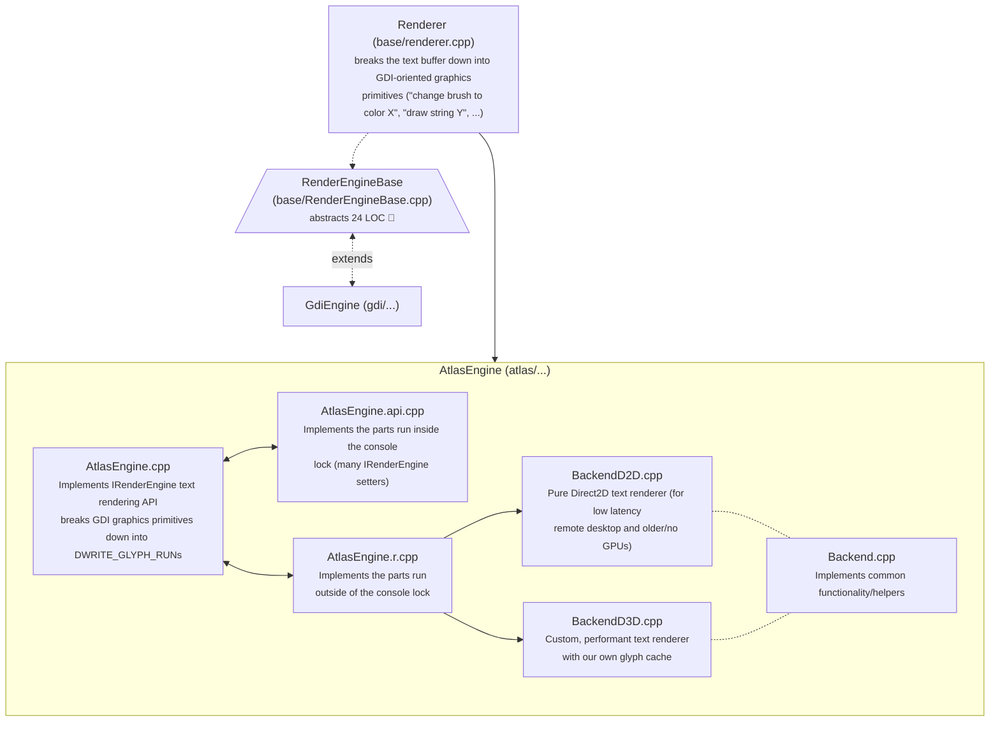
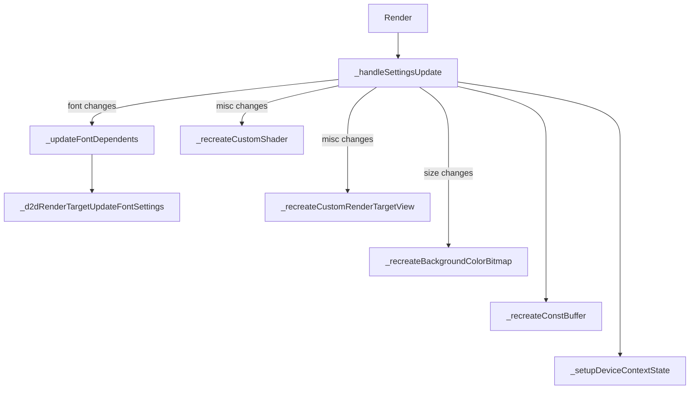
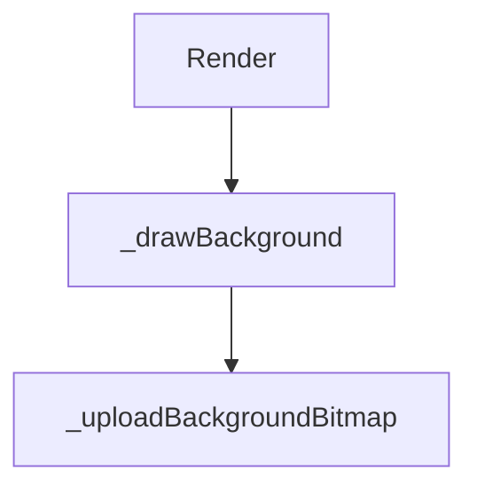
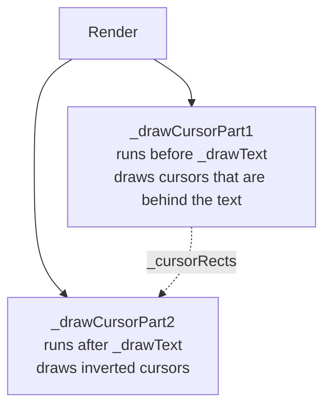
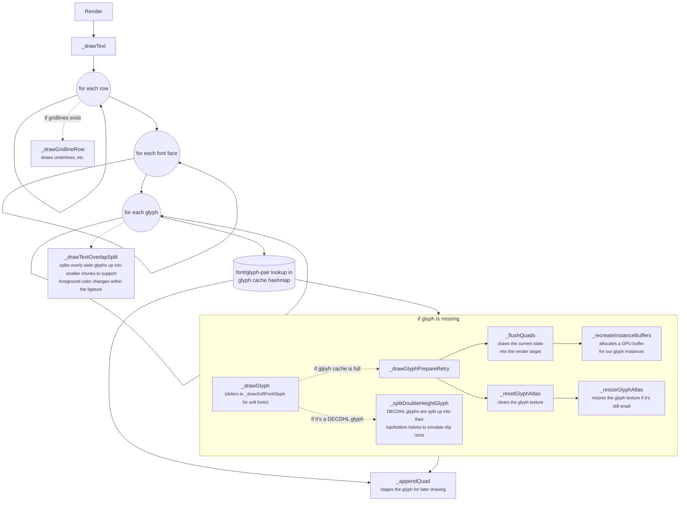
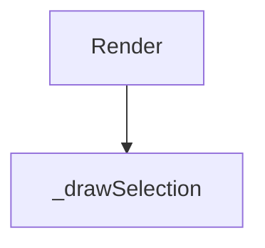
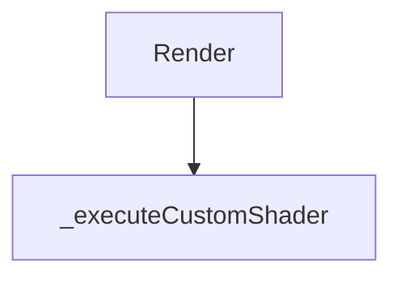
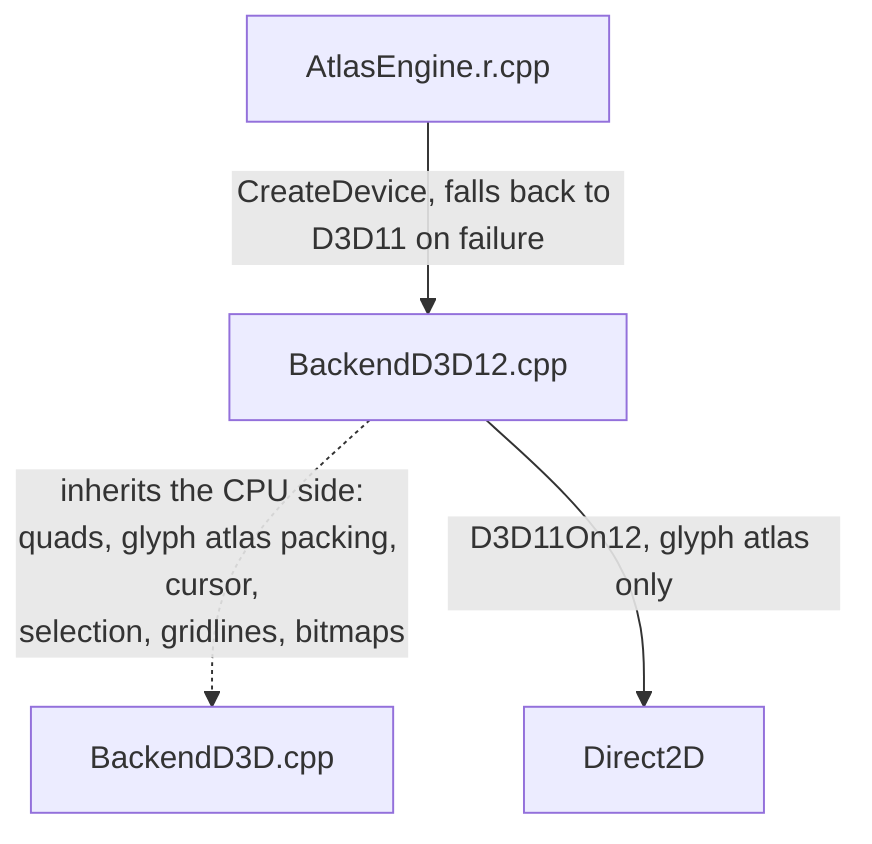

# AtlasEngine

## General architecture overview



As you can see, breaking the text buffer down into GDI-style primitives just to rebuild them into DirectWrite ones, is pretty wasteful. It's also incredibly bug prone. It would be beneficial if the TextBuffer and rendering settings were given directly to AtlasEngine so it can do its own bidding.

## BackendD3D

The primary entrypoint for rendering is `IBackend::Render` and `BackendD3D` implements it via the following functions, by calling them one by one in the order listed here.

### `_handleSettingsUpdate`



### `_drawBackground`



### `_drawCursorPart1` / `_drawCursorPart2`



### `_drawText`



### `_drawSelection`



### `_handleSettingsUpdate`



## BackendD3D12

`"rendering.graphicsAPI": "direct3d12"` selects `BackendD3D12`. `automatic` never selects it: it isn't faster than `BackendD3D` on the hardware it was measured on (see `tools/aphrody/bench-render.md`).



* `BackendD3D12` derives from `BackendD3D` and overrides the parts that touch the GPU: `_flushQuads`, `_uploadBackgroundBitmap`, `_resizeGlyphAtlas` and `_d2dBeginDrawing`/`_d2dEndDrawing`. Everything that turns rows into quads is shared, so both backends render identically.
* `d3d12.dll` is loaded at runtime. If device creation fails, `AtlasEngine` logs the error and uses Direct3D 11.
* The swap chain is created on the direct command queue. It keeps the flip model, the frame latency waitable object and the `Present1` dirty rects of `AtlasEngine::_present`.
* 3 frames in flight, a single fence. Instances, the background bitmap and the custom shader constants are written into a persistently mapped upload ring buffer, which grows when a single frame doesn't fit.
* Root signatures are written in HLSL (`shader_d3d12_rootsig.hlsl`) and embedded in the `*_d3d12.hlsl` vertex shaders, which wrap the regular shaders and are compiled for shader model 5.1. The pipeline states are created once.
* Direct2D can't draw into D3D12 resources, so the glyph atlas is a D3D12 texture wrapped by a D3D11On12 device that submits to the same queue. Draw calls recorded before Direct2D writes to the atlas again are submitted first, because they read its previous contents.

### Custom shaders with Direct3D 12

Shaders written for Direct3D 11 work unchanged. They're compiled for `ps_5_1`, and the following is available on top:

* **Multiple passes.** Optional entry points `pass1` to `pass7` run in that order before `main`. Intermediate passes render into `R16G16B16A16_FLOAT` targets (the size of the swap chain), `main` renders into the swap chain.
* **Textures.**
  * `t0`: output of the previous pass. For the first pass that's the terminal contents (same as with Direct3D 11).
  * `t1`: `experimental.pixelShaderImagePath` (same as with Direct3D 11).
  * `t2`: the terminal contents, in every pass.
  * `t3`: the final output of the previous frame, for trails or decay effects. Using it turns on continuous redraw.
* **Samplers.**
  * `s0`: linear, border, transparent black (same as with Direct3D 11).
  * `s1`: point, clamp.
  * `s2`: linear, clamp.
  * `s3`: linear, wrap.
* **Constant buffer `b0`.** The first 32 bytes are the Direct3D 11 layout.

  | Offset | Type     | Name          | Meaning                                                      |
  |-------:|----------|---------------|--------------------------------------------------------------|
  | 0      | `float`  | `time`        | seconds, wraps around after 1000 s                           |
  | 4      | `float`  | `scale`       | DPI / 96                                                     |
  | 8      | `float2` | `resolution`  | size of the text area in pixels                              |
  | 16     | `float4` | `background`  | premultiplied background color                               |
  | 32     | `float4` | `cursorRect`  | cursor left, top, right, bottom in pixels (0 when hidden)    |
  | 48     | `float4` | `cursorColor` | cursor color                                                 |
  | 64     | `float2` | `targetSize`  | size of the swap chain in pixels                             |
  | 72     | `float`  | `deltaTime`   | seconds since the previous frame (at most 1)                 |
  | 76     | `uint`   | `frameCount`  | frames drawn since the shader was loaded                     |
  | 80     | `float`  | `cursorTime`  | seconds since the cursor last moved (at most 1000)           |
  | 84     | `uint`   | `passIndex`   | index of the running pass (`main` is `passCount - 1`)        |
  | 88     | `uint`   | `passCount`   | number of passes                                             |

  ```hlsl
  cbuffer PixelShaderSettings : register(b0)
  {
      float  time;
      float  scale;
      float2 resolution;
      float4 background;
      float4 cursorRect;
      float4 cursorColor;
      float2 targetSize;
      float  deltaTime;
      uint   frameCount;
      float  cursorTime;
      uint   passIndex;
      uint   passCount;
  };
  ```
* **Continuous redraw** is enabled when any pass uses `time`, `deltaTime`, `frameCount`, `cursorTime` or `t3`, or when the shader can't be reflected. Otherwise the terminal is only redrawn when its contents change.
* Binding anything outside of `b0`, `t0`-`t3` and `s0`-`s3` makes pipeline creation fail. The error is reported like a compilation error.
